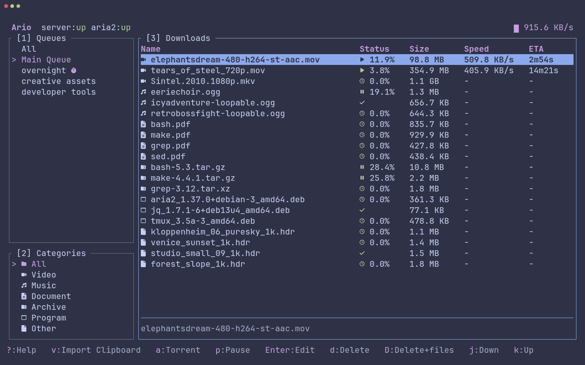

# Ario

**A batteries-included terminal download manager powered by aria2.**

[](https://github.com/peymanAzad/ario/actions/workflows/ci.yml)
[](LICENSE)
[](https://www.rust-lang.org/)
[](https://ratatui.rs/)
[](https://github.com/aria2/aria2)



Like the look of the demo? Set `theme = "catppuccin-frappe"` in `tui.toml`.

[Why Ario?](#why-ario) · [Features](#-features) · [Installation](#-installation) · [Quick start](#-quick-start) · [Configuration](#-configuration) · [Controls](#-controls) · [Contributing](#-contributing) · [License](#-license)

## Why Ario?

Ario combines aria2 with a managed daemon, scheduled queues, and batch clipboard import in one terminal workflow. It offers a terminal alternative to web front-ends like AriaNg, supports HTTP/HTTPS alongside BitTorrent, and keeps downloads and schedules running after you close the interface. The TUI and daemon can also run on separate machines, connected through an SSH tunnel.

## ✨ Features

- 🌙 **No extra window babysitting your downloads** — Close the TUI and get on with your work. The separate daemon keeps your downloads and scheduled queues running in the background.
- 🗓️ **Download on your schedule** — Set one-time, daily, or weekly download windows, including overnight schedules with automatic start and stop times.
- 🧲 **HTTP downloads and BitTorrent** — Manage HTTP/HTTPS downloads, magnet links, and `.torrent` files in one interface.
- 📋 **Batch imports from your clipboard** — Copy text containing download links and press `v`. Ario automatically finds HTTP/HTTPS URLs and magnet links, then lets you select items, choose a queue, and start downloading immediately or save them for later.
- ⚡ **Queue event commands** — Run scripts when every download succeeds or when a queue runs out of work or reaches its scheduled stop.
- 🎛️ **Your queues, your settings** — Prioritize downloads within each queue and control concurrency, connections, retries, file allocation, and piece selection. Set queue defaults and override them for individual downloads.
- 🦀 **Built for the terminal** — Written in Rust with Ratatui, with keyboard shortcuts and mouse support.
- 🗂️ **Automatic file organization** — Automatically categorize downloads by file type and save them to configurable folders.
- 🌐 **HTTP proxy support** — Configure aria2’s HTTP proxy in the daemon and monitor its reachability and ability to transfer data from the TUI.
- 🎨 **Make it yours** — Choose Catppuccin themes or custom colors, and select Nerd Font, Unicode, or ASCII icons. Configure the server address, automatic daemon startup, and daemon behavior when you exit.

## 📦 Installation

Every installation includes both `ario` (the TUI) and `ario_daemon`. Prebuilt
packages do not require Rust.

### Prerequisites

- **Nerd Font** — Optional, but strongly recommended for displaying Ario's default icons correctly. Select a Nerd Font in your terminal's font settings.

For terminals without a Nerd Font, launch with `ario --glyphs=unicode`.

### Linux (x86_64)

Linux release binaries require **glibc 2.35 or newer**.
If multiple versions of the same package are in your download directory, use
the exact filename of the version you want to install.

#### Debian and Ubuntu

Download `ario_<version>-1_amd64.deb` from the
[latest release](https://github.com/peymanAzad/ario/releases/latest), then run
this command in the download directory:

```sh
sudo apt install ./ario_*_amd64.deb
```

APT installs aria2 and the other required dependencies.

#### Fedora and other RPM-based distributions

Download `ario-<version>-1.x86_64.rpm` from the
[latest release](https://github.com/peymanAzad/ario/releases/latest), then run
this command in the download directory:

```sh
sudo dnf install ./ario-*.x86_64.rpm
```

DNF installs aria2 and the other required dependencies from your configured
repositories. Use your distribution's package manager if it does not use DNF.

#### Arch Linux

Download `ario-download-bin-<version>-1-x86_64.pkg.tar.zst` from the
[latest release](https://github.com/peymanAzad/ario/releases/latest), then run
this command in the download directory:

```sh
sudo pacman -U ./ario-download-bin-*-x86_64.pkg.tar.zst
```

Pacman installs aria2 and the other required dependencies. The package is named
`ario-download-bin`; launch it with `ario`. It conflicts with Arch's unrelated
`ario` music player because both install `/usr/bin/ario`.

To upgrade, install the newer package with `pacman -U`. This package is not
currently published to the AUR.

#### Other Linux distributions

The archive does not install aria2 automatically.
Install [aria2](https://github.com/aria2/aria2) with your distribution's package
manager and make sure `aria2c` is in your `PATH`. Download the
[Linux x86_64 archive](https://github.com/peymanAzad/ario/releases/latest/download/ario-x86_64-unknown-linux-gnu.tar.gz), then extract and install both executables:

```sh
tar -xzf ario-x86_64-unknown-linux-gnu.tar.gz
sudo install -d /usr/local/bin
sudo install -m 755 ario-x86_64-unknown-linux-gnu/ario \
  ario-x86_64-unknown-linux-gnu/ario_daemon /usr/local/bin/
```

Make sure `/usr/local/bin` is in your `PATH`.

### macOS (Apple Silicon and Intel)

Install [Homebrew](https://brew.sh/), then run:

```sh
brew install peymanAzad/tap/ario
```

Homebrew selects the binary for your Mac and installs aria2 automatically.

### Windows (x64)

The ZIP does not install aria2 automatically.

1. Install aria2 using WinGet:

   ```powershell
   winget install --id aria2.aria2 --exact
   ```

2. Download the [Windows x64 ZIP](https://github.com/peymanAzad/ario/releases/latest/download/ario-x86_64-pc-windows-msvc.zip) and extract it to a permanent location.
3. Add the directory containing **both** `ario.exe` and `ario_daemon.exe` to
   your user `Path` environment variable. Keep the two executables together.
4. Open a new terminal so the updated `Path` takes effect, then run `ario`.
   Make sure `aria2c` is also available in that terminal.

### Cargo (all platforms)

Install **Rust and Cargo 1.95 or newer** using [rustup](https://rust-lang.org/tools/install/).
Cargo and source installations do not install aria2 automatically; install it
separately so that `aria2c` is in your `PATH`.

Install the published [`ario` crate](https://crates.io/crates/ario):

```sh
cargo install ario --locked
```

Or build and install from this repository:

```sh
git clone https://github.com/peymanAzad/ario.git
cd ario
cargo install --locked --path .
```

Both commands install `ario` and `ario_daemon`. Make sure Cargo's executable
directory, usually `~/.cargo/bin` on Linux/macOS or `%USERPROFILE%\.cargo\bin`
on Windows, is in your `PATH`.

## 🚀 Quick start

1. **Launch Ario:**

   ```sh
   ario
   ```

   The local daemon and aria2 start automatically with the default configuration.

2. **Add your first download:** Copy one or more HTTP/HTTPS URLs or magnet links, then press `v` in Ario. Use `↑` / `↓` to navigate the detected links and `Space` to select or deselect them.

3. **Choose a queue and start:** Use `←` / `→` to choose the destination queue. Press `s` to start the selected downloads immediately, or `w` to save them for later.

4. **Leave downloads running:** Press `q` from the main screen to close the TUI. By default, the daemon stays running while downloads are active or scheduled queues are enabled. Run `ario` again to reconnect.

To add a local `.torrent` file, press `a` from the main screen, enter its path, press `Enter` to confirm, then `s` to start.

Press `?` from the main screen to view keyboard shortcuts.

## 🔧 Configuration

Ario creates `server.toml` and `tui.toml` automatically on first launch. Both files live in your configuration directory:

| Platform | Directory                                      |
| -------- | ---------------------------------------------- |
| Linux    | `$XDG_CONFIG_HOME/ario/`, or `~/.config/ario/` |
| macOS    | `~/Library/Application Support/ario/`          |
| Windows  | `%APPDATA%\ario\config\`                       |

The blocks below contain the default settings. Optional values are shown as commented examples.

### Daemon — `server.toml`

```toml
[settings]
default_download_location = "~/Downloads"

# Reserved settings; currently have no effect.
# Configure exit behavior in tui.toml under [on-app-exit].
start_daemon_on_login = false
stop_daemon_on_close = false

[settings.category_locations]
Video = "~/Downloads/Videos"
Music = "~/Downloads/Musics"
Document = "~/Downloads/Documents"
Archive = "~/Downloads/Compressed"
Program = "~/Downloads/Programs"

# Extensions are listed without a leading dot.
# Unrecognized file types use the default download location.
[settings.category_extensions]
Video = [
    "mp4", "mkv", "avi", "mov", "webm", "flv", "m4v", "wmv",
    "mpg", "mpeg", "m2v", "3gp", "3g2", "ogv", "ts", "mts",
    "m2ts", "vob", "asf",
]
Music = [
    "mp3", "flac", "wav", "aac", "ogg", "m4a", "opus", "wma",
    "aiff", "aif", "alac", "ape", "amr", "oga", "mka", "mid", "midi",
]
Document = [
    "pdf", "doc", "docx", "txt", "epub", "odt", "rtf", "xls",
    "xlsx", "ods", "csv", "ppt", "pptx", "odp", "html", "htm",
    "md", "tex", "mobi", "azw", "azw3", "djvu",
]
Archive = [
    "zip", "zipx", "rar", "7z", "tar", "gz", "xz", "bz2",
    "tgz", "tbz", "tbz2", "txz", "zst", "cab", "iso",
]
Program = [
    "exe", "msi", "apk", "deb", "rpm", "app", "dmg", "pkg",
    "bin", "run", "com", "jar", "appimage", "ipa", "appx",
    "msix", "msixbundle", "flatpak", "snap", "sh", "bat", "cmd", "ps1",
]

# Set enabled = true and supply an HTTP proxy host to route downloads through aria2's proxy.
# Port defaults to 80. For authentication, set username and password.
[settings.proxy]
enabled = false
# host = "127.0.0.1"
# port = 8080
# username = "username"
# password = "password"

[aria2]
# Executable name from PATH, or a full path to aria2c.
binary_path = "aria2c"

# Internal aria2 RPC port, separate from Ario's server port (47812).
rpc_port = 6800

# Initial directory passed to aria2.
# Ario routes downloads using the locations under [settings].
download_dir = "~/Downloads"
```

Aria2 uses the HTTP proxy for HTTP(S), FTP, and SFTP transfers. BitTorrent peers connect directly, and `no_proxy` exclusions still apply. The `all-proxy-user` and `all-proxy-passwd` options in `aria2.conf` override credentials from `server.toml`. The TUI shows `proxy:up no data` when the proxy is reachable but the latest Cloudflare probe failed to retrieve data.

### TUI — `tui.toml`

```toml
server_url = "http://127.0.0.1:47812"

# Start and supervise the daemon automatically for a local HTTP address.
# Set to false if you manage the daemon yourself.
auto_start_server = true

# Empty: look for ario_daemon beside the TUI executable, then in PATH.
# Set a full path to use a different executable.
server_binary = ""

mouse_enabled = true

# Choices: "default", "catppuccin-latte", "catppuccin-frappe",
# "catppuccin-macchiato", "catppuccin-mocha".
theme = "default"

# Choices: "nerd", "unicode", "ascii".
# Unset by default: UTF-8 locales use Nerd Font icons; others use ASCII.
# The --glyphs command-line option overrides this setting.
# glyph_mode = "unicode"

[on-app-exit]
# Applies to the TUI-managed daemon; manually started daemons stay running.
# "when_idle": stop only when no downloads are active and no schedules are enabled.
# "never": keep running after the TUI exits.
# "always": stop even when downloads are active.
stop_managed_daemon = "when_idle"

[custom_theme]
# No overrides by default; colors inherit the selected theme.
# Uncomment any example below to override it with a six-digit hex color.
# foreground = "#cdd6f4"
# border = "#6c7086"
# border_focused = "#89b4fa"
# selected_bg = "#313244"
# selected_fg = "#cdd6f4"
# status_ok = "#a6e3a1"
# status_error = "#f38ba8"
# status_warning = "#f9e2af"
# text_muted = "#a6adc8"
# accent = "#cba6f7"
```

Restart the TUI after changing `tui.toml`. Changes to `server.toml` require restarting the daemon; reopening the TUI alone may reconnect to the existing daemon.

### Queue event commands

In the queue create/edit modal, open the **Events** tab and enter either or both
commands. Leave a command blank to disable it. **Latest results** shows the
most recent run of each command and refreshes while the modal is open.

| Event                 | Trigger                                                                                                                                                  |
| --------------------- | -------------------------------------------------------------------------------------------------------------------------------------------------------- |
| **On success**        | Every item in a nonempty queue is Completed. Failed, paused, or retained Removed items prevent success.                                                  |
| **On automatic stop** | No active or automatically eligible downloads remain, or all required pauses at the scheduled stop succeed. Failed and manually paused items may remain. |

Successful completion runs **On success**, then **On automatic stop**, even if
the success command fails. Manually stopping the **queue** runs neither command;
individually pausing its last active download can trigger automatic exhaustion.
Aria2 retries still count as work. Empty or already idle queues do not fire events.

Each event runs at most once per run. Work starts a run through queue Start,
scheduled starts, Start immediately, or individual starts/retries. Additional work
joins an ongoing run; work started after it ends begins another run. An exhausted
queue keeps its existing behavior of accepting new work automatically. Exhaustion
before a scheduled deadline does not trigger the stop command again at that
deadline unless new work has begun. If completion coincides with the deadline,
successful completion takes precedence.

Commands execute **on the daemon's machine**, as the daemon user, with the Ario
configuration directory as their working directory. Linux/macOS use `/bin/sh -c`;
Windows uses `cmd.exe /D /S /C`. Use the corresponding shell's quoting and script
syntax. Commands inherit the daemon's environment and receive:

| Variable            | Value                                                |
| ------------------- | ---------------------------------------------------- |
| `ARIO_QUEUE_ID`     | Queue ID                                             |
| `ARIO_QUEUE_NAME`   | Queue name, passed literally through the environment |
| `ARIO_QUEUE_RUN_ID` | Run number within the queue                          |
| `ARIO_EVENT`        | `success` or `stop`                                  |
| `ARIO_STOP_REASON`  | `completed`, `exhausted`, or `scheduled_stop`        |

For example, a Linux/macOS command can invoke a script with the queue name:

```sh
/absolute/path/to/script.sh "$ARIO_QUEUE_NAME" "$ARIO_STOP_REASON"
```

On Windows, use `%ARIO_QUEUE_NAME%` and `%ARIO_STOP_REASON%` in the command instead.

Commands have no interactive input or attached terminal. Ario does not collect
passwords or grant administrator access. For a command requiring sudo, use
`sudo -n` with permission already configured for that specific command; otherwise
sudo exits with an error. Standard output and errors go to the daemon logs
(`server.log` for a TUI-managed daemon); the modal reports status, timestamps, and
command failures.

There is **no execution time limit**. Commands run sequentially within a queue,
including across successive runs; other queues and downloads continue normally.
A stuck success command delays that queue's stop command. Queued/running commands
keep a managed daemon alive under the default `when_idle` exit policy. Forced
shutdown interrupts outstanding commands and does not retry them.

Event attempts and command snapshots are saved before execution. Editing a
command affects future events, not attempts already queued. Following a daemon
restart, unfinished attempts are marked **interrupted** and **never replayed**.
A crash between recording an attempt and launching its command can therefore
cause a command to be missed. Downloads in a persisted run continue normally.

## 🧭 Controls

Use keyboard shortcuts or the mouse to navigate Ario. The footer shows available actions for your current selection.

Press `?` or click **Help** from the main screen for the full keyboard reference. Mouse support is enabled by default and can be disabled in `tui.toml`.

### Text inputs

Press `Enter` to edit the selected text field, such as the
queue name or an event command in the queue modal. Press `Enter` again to accept the draft or
`Esc` to discard it. Use **Save** to apply your queue changes or **Cancel** to
discard them.

## 🤝 Contributing

Bug reports, feature requests, documentation improvements, and pull requests are welcome.

For larger changes, [open an issue](https://github.com/peymanAzad/ario/issues) first to discuss your approach. When submitting a pull request, describe what changed, why, and how you tested it.

## 📄 License

Ario is licensed under the **MIT License**. See [LICENSE](LICENSE) for details.
